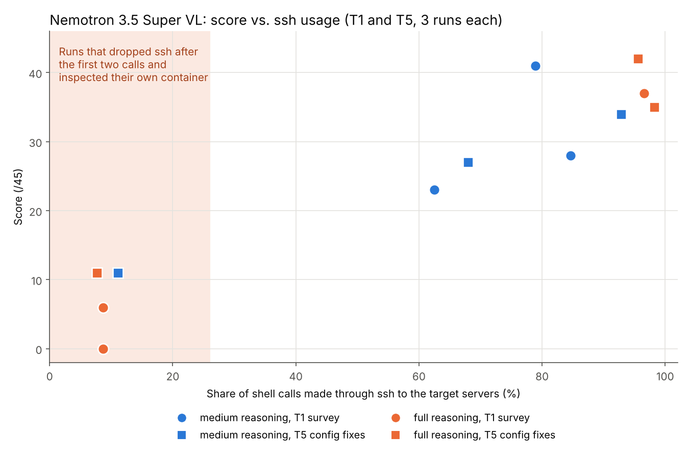

# Nemotron 3.5 Super VL on DGX Spark: strong at coding, but drops `ssh` mid-task in a sysadmin agent benchmark

**Model:** `nvidia/NVIDIA-Nemotron-3.5-Super-VL-120B-A12B-NVFP4` (released 2026-10-15)
**Hardware:** one NVIDIA DGX Spark (GB10, 128 GB unified memory)
**Baseline:** Qwen3.8-Flash-Next on the same DGX Spark, measured earlier with the same benchmark
**Measured:** 2026-10-20 to 2026-10-21, vLLM v0.32.0, OpenCode 2.0.25
**Japanese write-up (longer, includes 4-axis benchmarks):** https://qiita.com/nabe2030/items/fe4261db16d9b269a8e0

## TL;DR

1. **On GembaBench (investigate and fix a small company's web/DB servers), Nemotron 3.5 Super VL scored below Qwen3.8-Flash-Next on the same hardware.** It finished all 18 runs on its own (Flash-Next failed to deliver a report in 3 of 18) and was faster, but it missed a lot in the investigation tasks: 28/45 on the server survey vs. 43/45 for Flash-Next.
2. **The low-scoring runs share one failure mode: the agent stops using `ssh` after the first couple of commands and inspects its own container instead, then reports that as the state of the target server.** With full reasoning instead of medium, this happened in 3 of 6 runs (vs. 1 of 6), and the median T1 score fell from 28 to 6.
3. **The reasoning-token cap (8,192) was never hit in 24 runs.** The model ends its reasoning early on its own. "Think more" is not the fix.
4. On single-problem coding (Aider Polyglot), it is the best model we have measured on Spark: pass@2 65.8% vs. 56.9% for Flash-Next. The same "short reasoning, stops early" trait helps there and hurts in multi-server investigation.
5. Speculative decoding (LiLiCorr drafter) gives 1.4–1.7× at 1–16 concurrent requests. The model card's `--max-num-seqs 1` is a memory-safety setting, not an architectural limit: Mamba-2 state is allocated (1 + draft tokens)× per request under speculation.

## What GembaBench is

GembaBench is this repository's benchmark: a fictional small company's web server and DB server (Ubuntu 22.04, home-grown PHP inquiry app, MySQL) in Incus containers, reset to a known state before every run. The containers are seeded with leftovers of a departed employee (SSH key, DB user, admin account), traces of an intrusion, a cron job that reverts configuration every hour, operational scripts that must be read to be understood, and an SQL injection. The agent (model + harness) works from its own container and reaches the targets with `ssh target-web "..."` / `ssh target-db "..."`.

| Task | What the agent must do | Scoring |
|---|---|---|
| T1 | Survey the current state | facts found, 45 pts |
| T2 | Find traces of the intrusion | facts found, 8 pts |
| T3 / T3b | Plan the OS upgrade; follow a mid-task change of policy | 8 / 6 pts |
| T4 | Carry out the upgrade | 31 checks on the live server |
| T5 | Fix the configuration | 45 checks on the live server |
| T6 | Fix the SQL injection | 23 checks on the live server |

All scoring is automatic. T4–T6 check the actual server state, not the agent's report. Every task runs 3 times; we report median [min–max]. Details, scoring scripts and the Flash-Next results: see the repository root.

## Conditions

Same as the Flash-Next DGX Spark column in the first report, except for the model and the way reasoning effort is requested.

| Item | Value |
|---|---|
| Harness | OpenCode 2.0.25 |
| Reasoning | medium. Nemotron: `chat_template_kwargs: {"enable_thinking": true, "medium_effort": true}`. Flash-Next: `reasoning_effort: medium` |
| Reasoning-token cap | 8,192, enforced by a proxy between harness and server (see below) |
| Output cap / context | 16,384 / 245,760 tokens (sums to 262,144) |
| Concurrency | 1 run at a time |
| Runs | 3 per task (18), plus 6 extra runs with full reasoning (T1, T5) |
| Server | vLLM v0.32.0, `--max-model-len 262144 --max-num-seqs 4`, prefix caching on, **no LiLiCorr** (with the drafter, four 256K requests do not fit; see "Why max-num-seqs 1" below) |
| Small model for titles/summaries | a separate machine, never the Spark |

**What `medium_effort` does.** We had vLLM render the prompt via `/tokenize`. The only difference is a `{reasoning effort: efficient}` tag appended to the first user message. Nothing else changes.

**Reasoning cap.** vLLM has no per-request reasoning cap, so the proxy counts streamed reasoning chunks and, at 8,192, closes the thinking block and asks the model to continue with `continue_final_message`. The proxy is `budget_proxy/budget_proxy.py` in this repository. We verified before the runs, with short probe requests at a 512-token cap, that Nemotron continues correctly after a forced cut, does not restart its reasoning, and still emits tool calls. Chunk counting undercounts real tokens by about 6% on this server (vLLM sometimes packs two tokens into one chunk), so the effective cap is roughly 8,500–8,700 tokens. **It was never reached.** The longest single reasoning segment in 24 runs was 3,736 chunks.

## Results (medium reasoning, 18 runs)

| Task | Spark · Flash-Next | **Spark · Nemotron 3.5 Super VL** | Reference: RTX 4060 Ti 16 GB · Flash-Next (IQ3_S, Strata) |
|---|---:|---:|---:|
| T1 survey (/45) | 43 [38–45] | **28 [23–41]** | 40 [39–45] |
| T2 intrusion traces (/8) | 6 [6–8] | **5 [4–6]** | 7 [5–8] |
| T3 upgrade plan (/8) | 8 [8–8] | **7 [7–8]** | 8 [0–8] |
| T3b follow policy change (/6) | 2 [2–4] | **2 [2–4]** | 4 [0–4] |
| T4 upgrade (/31) | 31 [27–31], perfect 2/3 | **28 [25–31], perfect 1/3** | 31 [31–31], perfect 3/3 |
| T5 config fixes (/45) | 41 [11–43] | **27 [11–34]** | 39 [38–42] |
| T6 SQL injection fix (/23) | 23 [8–23], perfect 2/3 | **23 [23–23], perfect 3/3** | 23 [23–23], perfect 3/3 |

| | Spark · Flash-Next | **Spark · Nemotron** | Ref: 16 GB · Flash-Next |
|---|---:|---:|---:|
| Sum of median durations, 6 tasks (min) | ~257 | **~151** | ~106 |
| Runs that delivered a result | 15/18 | **18/18** | 17/18 |
| Early stops (model ended the turn with no result) | 2 | **0** | 1 |
| Time-outs | 1 | **0** | 0 |
| Max context utilisation | 84% | **49%** | 39% |
| Generation speed (tok/s, output ÷ generation time) | ~27 | **~18.5** | ~35 |

Observations:

- **Nemotron never stalled.** All 18 runs ended with the model declaring completion. Flash-Next on Spark stopped twice mid-task (once mid-reasoning, once after announcing "I will verify..." and calling no tool) and timed out once.
- **Shorter wall-clock time is not speed.** Nemotron generates slower than Flash-Next on the same Spark (no drafter in the agent configuration). It finishes sooner because it does less: in T1–T3 it used fewer than half the steps and output tokens.
- **T6 (read the code, fix the injection) was perfect 3/3.** That matches its Aider Polyglot result. T1, T2 and T5 (go through two servers, find everything) are where it falls behind, including behind Flash-Next quantised to 3 bits on a 16 GB consumer GPU.
- Report-vs-action mismatches (claims in the report not backed by executed commands): 0 in all 18 runs.

## The failure mode: dropping `ssh`

We looked at what the low-scoring runs actually did. The pattern is the same every time:

1. The first two shell calls are `ssh target-web "..."` and `ssh target-db "..."`. The targets answer correctly (`hk-web01`, `hk-db01`, Ubuntu 22.04.5); sshd logs confirm key-based logins.
2. From the third call on, the agent runs `hostname`, `cat /etc/passwd`, `dpkg -l`, ... **without `ssh`**, i.e. inside its own OpenCode container.
3. `hostname` returns the container's name. The agent does not notice and writes the findings up as the state of the target servers. One T1 report states that "the web server has no Nginx or PHP, the DB server has no MySQL, `/var/www` does not exist, no backups are taken" — none of which is installed in the agent's own container.

No command touched anything outside the agent's container. The damage is purely to the report.

The 12 runs of T1 and T5 (6 medium, 6 full reasoning) split cleanly on this:

| | Runs that kept using `ssh` | Runs that dropped `ssh` after 2 calls |
|---|---|---|
| Count | 8 | 4 |
| Share of shell calls via `ssh` | 63–98% | 8–11% |
| Score (/45) | 23–42 | 0–11 |

## Does more reasoning help? No — it made this worse

We reran T1 and T5 three times each with full reasoning (`{"enable_thinking": true}`, no `medium_effort`). Everything else unchanged.

| | medium | full |
|---|---:|---:|
| T1 survey (/45) | 28 [23–41] | **6 [0–37]** |
| T5 config fixes (/45) | 27 [11–34] | **35 [11–42]** |
| Runs that dropped `ssh` | 1/6 | **3/6** |
| Scores of runs that kept `ssh` | T1: 23, 41, 28 · T5: 27, 34 | T1: 37 · T5: 35, 42 |
| Median reasoning per request (range over runs, chunks) | 120–392 | 198–716 |
| Reasoning-cap hits | 0 | 0 |

Reasoning got 1.5–2× longer per request. Runs that kept using `ssh` scored higher than any medium run. But the drop-`ssh` failure went from 1/6 to 3/6, and those three runs scored 0, 6 and 11. With n=3 per cell we do not claim the direction is significant; we do claim that increasing reasoning effort is not a fix for this failure mode. Classmethod's independent first-look (Japanese) also found medium reasoning better than full for its agent-fitness probes (6/6 vs. 4/6): https://dev.classmethod.jp/articles/dgx-spark-nemotron-3-5-super-vl-first-touch/

**Recommendation for agent use: medium reasoning.**

## What we would try on the harness side (untested)

GembaBench deliberately gives the model no help here, to compare models as they are. For real use, we would:

- State in the agent's rules file (e.g. `AGENTS.md`) that every command against the targets must be wrapped in `ssh target-...`.
- Better: expose the targets as dedicated tools (a `run_on_web`/`run_on_db` shell tool) and disallow local shell execution.
- Require the agent to record `hostname` output in the report before concluding.

Whether a rules-file instruction alone is enough is an open question; we have not measured it.

## Why the model card says `--max-num-seqs 1`

The DGX Spark quick-start on the model card serves one request at a time with the LiLiCorr drafter (DFlash, 7 draft tokens). We read vLLM v0.32.0 to see why.

- The `dflash` implementation has no single-sequence assumption; buffers are allocated per in-flight request. We served 32 concurrent requests without errors.
- What limits concurrency is memory: under speculative decoding, the **Mamba-2 state is allocated (1 + num_speculative_tokens)× per request** (`vllm/v1/kv_cache_interface.py`), so that the state can be rolled back when a draft is rejected. With 7 draft tokens that is 8×.
- Measured on Spark at `--gpu-memory-utilization 0.75`: without the drafter, 32+ concurrent 9K-token requests fit (18% of the pool); with the drafter, 8 fit (89%). For short ShareGPT requests the drafter configuration tops out at 16 concurrent.

So `--max-num-seqs 1` is the value that is safe for any prompt length. For prompts that are not extreme, 8–16 is fine with the drafter. For agent use with 256K context we ran 4 concurrent without the drafter and with prefix caching on; the second and later turns of a long conversation then return their first token in 1–2 s (prefix of 243K tokens: 60.9× faster TTFT than cold).

Throughput we measured (aggregate output tok/s, `vllm bench serve`, ShareGPT, 200 prompts, no reasoning, `--max-model-len 32768`, draft tokens = 7 as in the model card):

| concurrency | no drafter | LiLiCorr | Flash-Next (SGLang, no MTP) |
|---:|---:|---:|---:|
| 1 | 19.2 | **32.9** | 27.0 |
| 4 | 44.1 | **62.2** | 51.6 |
| 8 | 59.1 | **88.2** | 67.7 |
| 16 | 78.6 | **129.5** | 77.5 |
| 32 | **105.7** | (16 in flight) | 89.4 |

Draft acceptance per position (c=8): 76.8 / 57.5 / 41.9 / 30.8 / 22.7 / 17.1 / 12.5%, i.e. 3.6 tokens per verification, flat across concurrency. Others report higher single-stream speeds with fewer draft tokens (4 instead of 7); we did not measure that. See https://github.com/kindlingai/nemotron-3.5-super-vl-dgx-spark and https://github.com/sfxnz/NVIDIA-Nemotron-3.5-Super-VL-120B-A12B-NVFP4-DGX-SPARK.

## Other measurements (summary)

| Axis | Result |
|---|---|
| Coding, Aider Polyglot (225 problems, whole format, 2 attempts, default reasoning) | pass@1 27.1%, **pass@2 65.8%** (Flash-Next: 32.4% / 56.9%). Context overflow in 1 of 450 attempts (Flash-Next: 198). The model fixes what it got wrong on the first try, and its reasoning is short enough never to blow the budget. |
| Japanese knowledge, JamC-QA (2,309 questions, 3-shot, no reasoning) | 64.01%, on par with Flash-Next (64.57%), +4.7 pt over Nemotron 3 Super. All 18 GembaBench reports were written in Japanese (the task language); the previous generation sometimes answered in English. |
| Vision (8 real photos: caption, JSON extraction, PPE detection) | 100% well-formed JSON with and without reasoning. With reasoning on, up to 2,314 reasoning tokens per image: raise `max_tokens`. |

## Limits of this report

- n=3 per task, 6 tasks, one scenario, one harness (OpenCode 2.x). Differences within a few points are noise.
- All scoring is automatic. T1–T3 score facts found in the report; T4–T6 check the live servers.
- The same Spark served both models, but different engines (vLLM for Nemotron, SGLang for Flash-Next) and the drafter was off for the agent runs.
- The `ssh`-drop finding is from 12 runs of two tasks. We have not tested whether it appears in other harnesses or with a different tool layout.

## Files

- `trials.csv`: all 18 medium-reasoning runs (T3b scored separately from T3) and the 6 full-reasoning runs, with duration, score, shell-call counts, `ssh` share, and reasoning length. Thinking lengths are proxy chunk counts (≈ tokens, −6%).
- `fig6_ssh.png`: score vs. share of shell calls made through `ssh`, T1 and T5, medium and full reasoning.

Measured by the IoT Media Laboratory (NPO), Tokyo. Questions: nabe@gridtech.jp
